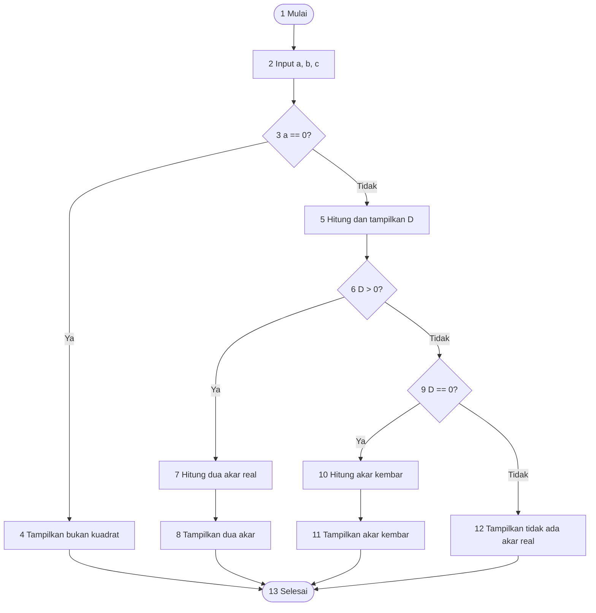
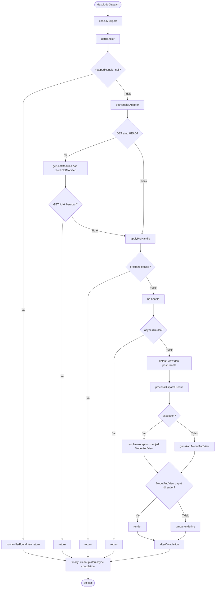

# Program Persamaan Kuadrat dan Analisis Path Testing

## A. Source Code

```python
import math


def main():
    print("Program Persamaan Kuadrat ax^2 + bx + c = 0")
    a = float(input("Masukkan nilai a: "))
    b = float(input("Masukkan nilai b: "))
    c = float(input("Masukkan nilai c: "))

    if a == 0:
        print("Bukan persamaan kuadrat karena a harus bukan 0.")
    else:
        diskriminan = b**2 - 4 * a * c
        print(f"Diskriminan (D) = {diskriminan:g}")

        if diskriminan > 0:
            akar_1 = (-b + math.sqrt(diskriminan)) / (2 * a)
            akar_2 = (-b - math.sqrt(diskriminan)) / (2 * a)
            print("D > 0: memiliki dua akar real berbeda.")
            print(f"x1 = {akar_1:g}")
            print(f"x2 = {akar_2:g}")
        elif diskriminan == 0:
            akar = -b / (2 * a)
            print("D = 0: memiliki satu akar real kembar.")
            print(f"x1 = x2 = {akar:g}")
        else:
            print("D < 0: tidak memiliki akar real.")


if __name__ == "__main__":
    main()
```

## B. Penjelasan Program

Program menerima koefisien `a`, `b`, dan `c` untuk persamaan `ax^2 + bx + c = 0`.
Program menolak input ketika `a = 0`, menghitung diskriminan `D = b^2 - 4ac`,
kemudian mengklasifikasikan dan menghitung akar sesuai nilai diskriminan.

## C. Node Program

| Node | Pernyataan |
|---|---|
| 1 | Mulai `main()` |
| 2 | Tampilkan judul dan baca `a`, `b`, `c` |
| 3 | Keputusan `a == 0` |
| 4 | Tampilkan pesan bukan persamaan kuadrat |
| 5 | Hitung dan tampilkan diskriminan |
| 6 | Keputusan `D > 0` |
| 7 | Hitung dua akar real |
| 8 | Tampilkan klasifikasi `D > 0` dan kedua akar |
| 9 | Keputusan `D == 0` |
| 10 | Hitung akar kembar |
| 11 | Tampilkan klasifikasi `D == 0` dan akar |
| 12 | Tampilkan klasifikasi `D < 0` |
| 13 | Selesai |

Node 2 mencakup tiga operasi input berurutan. Node 7 dan 8, serta node 10 dan
11, dipisahkan agar perhitungan dan keluaran pada source code terlihat jelas.

Catatan instruksi pendukung di luar alur keputusan `main()`:

- `import math` memuat modul standar untuk `math.sqrt()` sebelum program
  dijalankan; instruksi ini tidak menambah decision atau jalur runtime.
- `if __name__ == "__main__": main()` menjadi gerbang pemanggilan `main()` saat
  file dijalankan langsung. Karena seluruh alur yang diuji berada di dalam
  `main()`, blok ini tidak menambah jalur independen pada CFG utama.

## D. Decision dan Kondisi

| Decision | Kondisi True | Kondisi False |
|---|---|---|
| D1 | `a == 0` menuju node 4 | `a != 0` menuju node 5 |
| D2 | `D > 0` menuju node 7 | `D <= 0` menuju node 9 |
| D3 | `D == 0` menuju node 10 | `D < 0` menuju node 12 |

D2 dan D3 hanya dijalankan jika D1 bernilai false. Pada source code, `D2`
menggunakan `if`, sedangkan D3 menggunakan `elif`.

## E. Control Flow Graph (CFG)



CFG memiliki satu node awal (1), satu node akhir (13), dan tiga node
keputusan (3, 6, 9). Semua edge pada diagram mengikuti urutan eksekusi source
code.

## F. Cyclomatic Complexity

Cyclomatic complexity dihitung dengan dua cara berikut:

1. Berdasarkan jumlah decision: `V(G) = jumlah decision + 1 = 3 + 1 = 4`.
2. Berdasarkan edge dan node: `V(G) = E - N + 2 = 15 - 13 + 2 = 4` bila
   semua node pada tabel dihitung satu per satu.

Agar perhitungan konsisten dengan CFG, node output yang selalu berurutan
digabung sebagai satu blok dasar: node 7-8 menjadi satu blok dan node 10-11
menjadi satu blok. Dengan demikian CFG dasar memiliki `N = 11`, `E = 13`,
dan `V(G) = 13 - 11 + 2 = 4`. Nilai cyclomatic complexity program adalah
**4**, sesuai dengan tiga decision pada source code.

## G. Independent Path

Empat independent path yang mencakup setiap outcome decision adalah:

| Path | Urutan node | Kondisi |
|---|---|---|
| P1 | 1-2-3-4-13 | `a == 0` |
| P2 | 1-2-3-5-6-7-8-13 | `a != 0` dan `D > 0` |
| P3 | 1-2-3-5-6-9-10-11-13 | `a != 0` dan `D == 0` |
| P4 | 1-2-3-5-6-9-12-13 | `a != 0` dan `D < 0` |

P1 adalah jalur validasi, sedangkan P2-P4 adalah tiga klasifikasi
diskriminan. Keempat jalur membentuk basis path untuk `V(G) = 4`.

## H. Test Case Path Testing

| Test case | Input `a, b, c` | Diharapkan | Path |
|---|---|---|---|
| TC1 | `0, 2, 1` | Pesan bukan persamaan kuadrat | P1 |
| TC2 | `1, -5, 6` | `D = 1`, akar `3` dan `2` | P2 |
| TC3 | `1, 2, 1` | `D = 0`, akar kembar `-1` | P3 |
| TC4 | `1, 2, 5` | `D = -16`, tidak ada akar real | P4 |

## I. Expected Output

### TC1

```text
Bukan persamaan kuadrat karena a harus bukan 0.
```

### TC2

```text
Diskriminan (D) = 1
D > 0: memiliki dua akar real berbeda.
x1 = 3
x2 = 2
```

### TC3

```text
Diskriminan (D) = 0
D = 0: memiliki satu akar real kembar.
x1 = x2 = -1
```

### TC4

```text
Diskriminan (D) = -16
D < 0: tidak memiliki akar real.
```

Baris judul dan tiga baris prompt input tidak ditampilkan pada cuplikan agar
fokus pada keluaran program setelah input diberikan.

## J. Kesimpulan Path Testing

Empat jalur independen berhasil menguji validasi `a`, kasus dua akar real,
akar real kembar, dan tidak adanya akar real. Setiap decision serta seluruh
klasifikasi diskriminan pada source code tercakup, sehingga path testing
memberikan cakupan cabang yang lengkap untuk program ini.

---

# Analisis Open-Source: `DispatcherServlet`

## A. Identitas Source yang Dianalisis

Analisis kedua ini menggunakan source asli Spring Framework, bukan implementasi
yang disederhanakan. Ref yang dipakai adalah tag stabil `v6.2.10` pada repository
resmi `spring-projects/spring-framework`.

- **Package:** `org.springframework.web.servlet`
- **Class:** `org.springframework.web.servlet.DispatcherServlet`
- **Modul/path:** `spring-webmvc/src/main/java/org/springframework/web/servlet/DispatcherServlet.java`
- **Ref/versi:** `v6.2.10`
- **URL source:** <https://github.com/spring-projects/spring-framework/blob/v6.2.10/spring-webmvc/src/main/java/org/springframework/web/servlet/DispatcherServlet.java>
- **Raw source:** <https://raw.githubusercontent.com/spring-projects/spring-framework/v6.2.10/spring-webmvc/src/main/java/org/springframework/web/servlet/DispatcherServlet.java>

Nomor baris di bawah merujuk pada file pada ref tersebut. Analisis ini adalah
analisis statis terhadap satu class; angka kompleksitas dan skenario di sini
tidak menyatakan bahwa seluruh test suite Spring telah dijalankan.

## B. Peran dan Fungsi Utama

`DispatcherServlet` adalah **Front Controller** Spring MVC. Servlet ini menjadi
titik masuk terpusat untuk request HTTP, lalu memilih handler, menjalankan
handler melalui adapter, menangani exception, dan merender hasilnya. Class ini
extends `FrameworkServlet`, sehingga lifecycle dan pemanggilan `doService` juga
berhubungan dengan infrastruktur servlet Spring.

Alur orkestrasi utamanya adalah:

1. **Routing:** `getHandler(request)` mencoba setiap `HandlerMapping` secara
   berurutan (sekitar baris 1281). Mapping menghasilkan `HandlerExecutionChain`
   yang berisi handler dan interceptor.
2. **Adaptasi handler:** `getHandlerAdapter(handler)` mencari
   `HandlerAdapter` yang mendukung handler tersebut. Dengan demikian servlet
   tidak perlu mengetahui semua tipe controller secara langsung.
3. **Eksekusi lifecycle:** `applyPreHandle`, `ha.handle(...)`, dan
   `applyPostHandle` menjalankan interceptor serta handler.
4. **Exception:** exception diproses oleh `processHandlerException(...)` dan
   daftar `HandlerExceptionResolver`, sehingga exception dapat diubah menjadi
   `ModelAndView`.
5. **Resolusi dan rendering:** `render(...)` memilih `View` langsung atau meminta
   `ViewResolver` menerjemahkan nama view, lalu memanggil
   `view.render(model, request, response)`.

Selain itu, source juga menangani multipart request, locale, async processing,
default view name, status HTTP, dan cleanup resource. Fitur tersebut menjadi
bagian dari koordinasi Front Controller, bukan routing alternatif.

## C. Struktur Class dan Method Nyata

Deklarasi class pada source adalah:

```java
public class DispatcherServlet extends FrameworkServlet
```

Field strategi yang terlihat pada source antara lain `handlerMappings`,
`handlerAdapters`, `handlerExceptionResolvers`, `viewResolvers`,
`multipartResolver`, `localeResolver`, `viewNameTranslator`, dan
`flashMapManager`. Flag `detectAllHandlerMappings`,
`detectAllHandlerAdapters`, `detectAllHandlerExceptionResolvers`, dan
`detectAllViewResolvers` mengatur apakah semua bean bertipe terkait dicari atau
bean dengan nama standar yang digunakan.

Inisialisasi strategi dilakukan oleh method nyata berikut:

| Method | Perilaku yang dianalisis |
|---|---|
| `initHandlerMappings(ApplicationContext)` | Mencari semua `HandlerMapping`, atau bean `handlerMapping`; bila tidak ada, memakai default strategy dan mengaktifkan `parseRequestPath` bila mapping memakai path pattern. |
| `initHandlerAdapters(ApplicationContext)` | Mencari semua `HandlerAdapter`, atau bean `handlerAdapter`; bila tidak ada, memakai default strategy. |
| `initHandlerExceptionResolvers(ApplicationContext)` | Mencari resolver exception, atau bean `handlerExceptionResolver`; bila tidak ada, memakai default strategy. |
| `initViewResolvers(ApplicationContext)` | Mencari semua `ViewResolver`, atau bean `viewResolver`; bila tidak ada, memakai default strategy. |
| `doService(request, response)` | Menyiapkan attribute request dan meneruskan dispatch ke `doDispatch`. |
| `doDispatch(request, response)` | Menjalankan alur routing, adapter, handler, async, exception, completion, dan multipart cleanup. |
| `processDispatchResult(...)` | Mengubah exception menjadi `ModelAndView` bila perlu, merender view, lalu memicu completion. |
| `render(ModelAndView, request, response)` | Menentukan locale, meresolusi view, menetapkan status, dan memanggil `View.render`. |

## D. Analisis Percabangan Source

### 1. `initHandlerMappings`

Pada source baris 601-645, `detectAllHandlerMappings` membagi alur menjadi
pencarian semua bean atau pencarian bean bernama `handlerMapping`. Jika hasil
pencarian tidak mengisi field, `getDefaultStrategies(...)` memasang strategi
default. Setelah itu loop memeriksa `mapping.usesPathPatterns()` dan berhenti
ketika menemukan mapping yang memakai path pattern.

Pola yang sama digunakan oleh `initHandlerAdapters`, `initHandlerExceptionResolvers`,
dan `initViewResolvers` (baris 647-789), tetapi masing-masing memakai tipe
strategi yang berbeda. Ini menunjukkan bahwa orkestrasi dapat dikonfigurasi
melalui application context dan tetap memiliki fallback.

### 2. `doDispatch`

Pada source baris 1049-1146, cabang pentingnya adalah:

- `checkMultipart` dapat mengembalikan request yang sudah dibungkus.
- Jika `getHandler` mengembalikan `null`, `noHandlerFound(...)` dipanggil dan
  dispatch selesai.
- Untuk GET atau HEAD, `getLastModified(...)` dipakai; request GET dapat
  selesai lebih awal bila `checkNotModified(...)` bernilai true.
- `applyPreHandle(...)` dapat menghentikan pemrosesan.
- Setelah `ha.handle(...)`, async yang dimulai menyebabkan return lebih awal.
- Exception biasa disimpan sebagai `dispatchException`; `Throwable` dibungkus
  menjadi `ServletException`, lalu keduanya diteruskan ke
  `processDispatchResult(...)`.
- Pada `finally`, request multipart dibersihkan untuk alur sinkron. Untuk alur
  async, `applyAfterConcurrentHandlingStarted(...)` dipanggil dan status
  multipart disimpan.

`doDispatch` tidak langsung melakukan semua pekerjaan view. Ia menyerahkan hasil
ke `processDispatchResult`, sehingga pemilihan handler, penanganan error, dan
rendering tetap memiliki tanggung jawab yang terpisah.

### 3. `processDispatchResult`

Pada source baris 1148-1193, exception yang ada dibedakan menjadi
`ModelAndViewDefiningException` atau diproses melalui
`processHandlerException(...)`. Bila hasilnya bukan `null` dan belum di-clear,
`render(...)` dipanggil. Jika async dimulai saat proses forward, method return
sebelum `triggerAfterCompletion`; selain itu completion dipicu pada mapped
handler.

### 4. `render`

Pada source baris 1400-1443, locale ditentukan dari `localeResolver` atau
`request.getLocale()`. Jika `ModelAndView` memiliki nama view, nama itu
di-resolve melalui `resolveViewNameInternal`, yang mencoba setiap
`ViewResolver` sampai mendapat `View` non-null. Jika tidak memiliki nama view,
source mengharapkan object `View` langsung. Kedua kegagalan tersebut
melempar `ServletException`.

Terakhir, status dari `ModelAndView` (bila ada) diterapkan ke response dan
`view.render(...)` dipanggil. Exception saat rendering dicatat lalu dilempar
kembali, bukan ditelan.

## E. Control Flow Graph (CFG) `doDispatch`

CFG berikut sengaja disederhanakan ke blok dasar utama. `catch` ditampilkan
sebagai alur error, sedangkan operand short-circuit pada `||` dan `&&` tidak
dijadikan node terpisah.



## F. Cyclomatic Complexity Statis

Untuk fokus yang dapat diaudit, kompleksitas dihitung hanya untuk method
`doDispatch`, bukan seluruh class yang memiliki banyak method dan strategi.
Dengan CFG ringkas di atas, terdapat **7 decision `if` eksplisit** yang
dihitung sebagai blok keputusan:

1. handler tidak ditemukan;
2. method GET/HEAD;
3. request GET tidak berubah;
4. `preHandle` menghentikan request;
5. async dimulai setelah handler;
6. async dimulai pada blok `finally`;
7. mapped handler ada pada blok async `finally`.

Dengan konvensi tersebut, `V(G) = jumlah decision + 1 = 7 + 1 = 8`.
Perhitungan ini **tidak memecah** operand `||`/`&&` menjadi decision tambahan
dan **tidak menganggap `catch` sebagai decision independen**. Jika alat ukur
yang dipakai memecah short-circuit atau menghitung exception edge, hasilnya
dapat lebih tinggi; karena itu angka 8 harus dibaca sebagai metrik statis
berdasarkan CFG ringkas yang didefinisikan di sini.

## G. Independent Path dan Skenario Branch

Skenario berikut memetakan cabang nyata pada source. Ini adalah rancangan
path/branch test statis dan bukan klaim bahwa test framework Spring dijalankan.

| ID | Kondisi/masukan konseptual | Cabang yang dicakup | Hasil yang diharapkan |
|---|---|---|---|
| DS-1 | Request tidak memiliki handler | `mappedHandler == null` | `noHandlerFound(...)`, dispatch return, lalu cleanup normal. |
| DS-2 | Handler ditemukan, method GET, resource belum berubah | GET/HEAD true dan `checkNotModified` true untuk GET | Return sebelum handler dipanggil. |
| DS-3 | `applyPreHandle(...)` mengembalikan `false` | preHandle false | Handler tidak dipanggil dan dispatch return. |
| DS-4 | Handler menghasilkan `ModelAndView` sinkron | adapter handle, async false, exception null | `processDispatchResult` memanggil `render`, lalu after-completion. |
| DS-5 | Handler melempar exception yang dapat di-resolve | `dispatchException != null` | `HandlerExceptionResolver` menghasilkan view/error response, lalu render atau completion. |
| DS-6 | Handler memulai async | async true setelah `handle` atau pada finally | Tidak melakukan cleanup sinkron; memanggil concurrent-handling callback. |
| DS-7 | `ViewResolver` tidak menemukan view | `resolveViewName(...) == null` | `render` melempar `ServletException`, bukan mengembalikan sukses palsu. |
| DS-8 | Multipart request sinkron | `multipartRequestParsed` true | Resource multipart dibersihkan pada `finally`. |

Skenario di atas mencakup cabang routing gagal, conditional GET, interceptor,
eksekusi normal, exception resolution, async, kegagalan view resolution, dan
cleanup multipart. Untuk pengujian runtime yang sesungguhnya masih diperlukan
fixture Servlet API, application context, handler, adapter, resolver, dan
mock response yang sesuai.

## H. Kesimpulan Analisis

`DispatcherServlet` memusatkan alur request tanpa mengikat dirinya pada satu
jenis controller. `HandlerMapping` menentukan tujuan, `HandlerAdapter`
menjembatani variasi handler, `HandlerExceptionResolver` mengubah error menjadi
hasil yang dapat diproses, dan `ViewResolver`/`View` merender response. Branch
pada `doDispatch` memperlihatkan bahwa return awal untuk no-handler,
conditional GET, pre-handle, dan async sama pentingnya dengan jalur sukses.
Dengan batasan scope yang dinyatakan, CFG ringkas menghasilkan cyclomatic
complexity 8 dan delapan skenario statis untuk menelusuri jalur utamanya.
